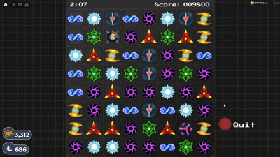

# Disc Drop Macro
### A fast and lightweight macro designed for Loomian Legacy's Disc Drop minigame.

#### The use of automated task programs (macros) in Loomian Legacy is strictly forbidden, and may get you banned. I've been testing it for months and have had no issues, but I will assume NO responsibility if you get caught and punished. Use this software at your own risk.

## State of Developement
- This is the first and last version of this macro. I have no plans to continue development unless Disc Drop gets updated.

## Compatibility
- This program only has support for Windows 10 and 11. I have neither the will nor the means to produce releases for MacOS or mobile.

## Features and Specifications
- This macro is entirely image recognition based, offering a safer alternative to invasive kernel-level cheat programs. It uses ~55MB of RAM and very little CPU power, so it should run with no issues on any shitty desktop, SBC or mini-PC.
- The Tix output is completely dependent on luck, but, assuming no interruptions, it averages between 60k and 70k Tix a day, burning through anywhere between 40k and 50k Loomicoins in the process.
- The algorithm for finding moves isn't anything special. It doesn't attempt to find the "best" move, rather it just plays the first one it sees.
- There is no auto-rejoin feature, so you have to manually check from time to time if you got disconnected. There is also no multi-monitor support, I have no idea how this macro behaves when used in such an environment.

## Download
- In the Releases section, you can download the .exe file and the source code. No installation is required, just launch the .exe file and you're good to go. I unfortunately don't have the possibility to get my program signed, so Windows Defender will flag it as dangerous. You can bypass this by clicking More information -> Run anyway.

- If you don't trust the .exe file (rightfully so), you can build the program yourself. It is written entirely in C++ with no additional dependencies, and you have tons of options for compiling the source code yourself. By far the easiest way to do this is with the [Microsoft Visual Studio IDE](https://visualstudio.microsoft.com/).

## Instruction Manual
- Go to Display settings, set resolution to 1920x1080.
- Disable any shaders and custom fonts, and press F11 to go fullscreen in Roblox.
- Ensure there are NO pop-ups, overlays, notifications or picture-in-picture videos.
- You cannot do anything on your device until you stop the macro.
- When ready, go to the Disc Drop arcade and start playing.
- After launching the macro and pressing Enter, you will have 5 seconds to go back to Roblox before it starts.
- Press Q at any point to stop and close the macro. You might need to mash it...

## Contribute
- This program is completely free and the code is open-source. You are allowed to copy, modify and redistribute it to your liking as per the MIT license. However, I am not interested in working with anyone else on this branch. If you wish to make any changes, create a new branch.
